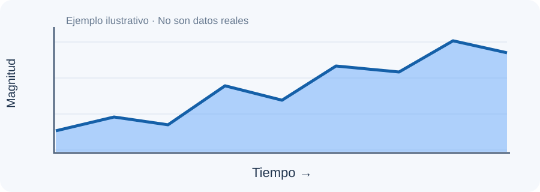
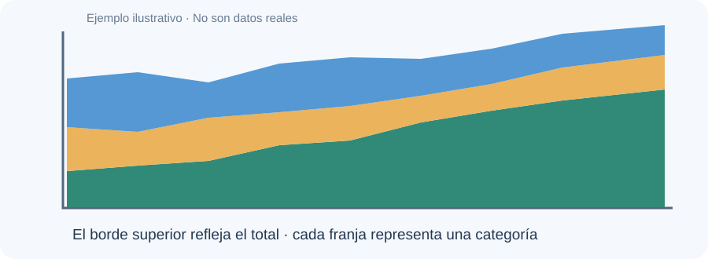
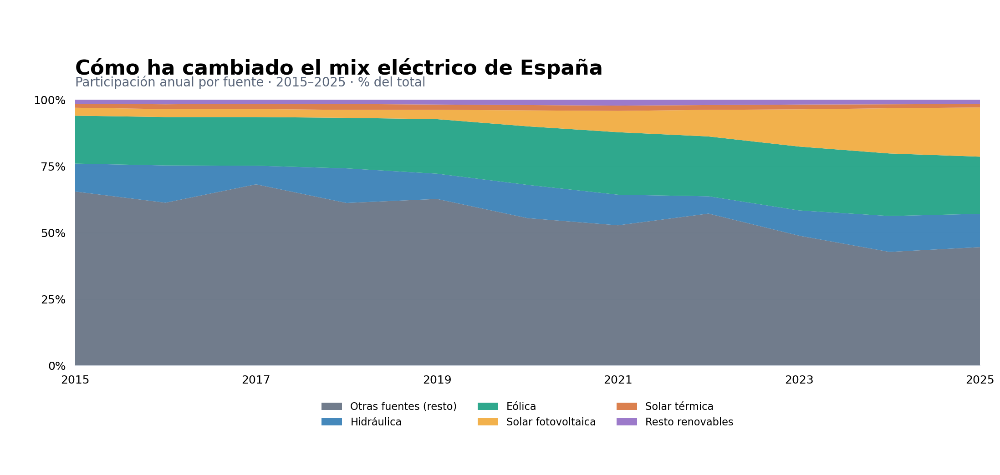
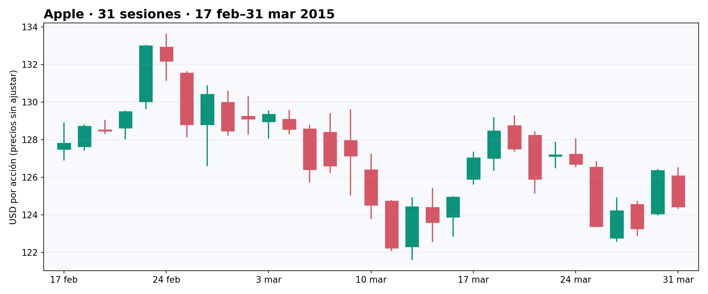
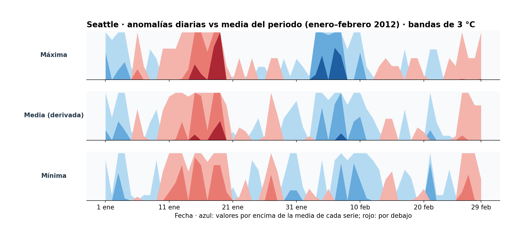

# PEC 2 · Técnicas de visualización de datos

**Tres representaciones · Tres preguntas · Tres fuentes de datos**

> Recorrido visual para la grabación. El discurso completo está en el TXT de Droppy. Las imágenes se muestran desde `imagenes/`.

---

## 01 / 03 · Area Chart

### ¿Cómo ha cambiado la composición eléctrica española?

**Origen:** tradición de William Playfair (finales del s. XVIII) · **Datos:** tiempo + cantidad + categoría · **Canales:** posición, espesor de área y color.

### Simple · Apilada · 100 % apilada

**Una magnitud / total y partes / proporciones relativas.**

### Caso práctico · España 2015–2025

**Solar fotovoltaica: 3 % → 18,5 %** · +15,5 puntos porcentuales.

**A favor:** lectura del cambio de composición. **Límites:** sin línea base común para todas las bandas; el apilado al 100 % oculta los GWh.

**Datos:** 11 años × 5 categorías renovables, más residual calculada. Sin máximo teórico de filas; demasiadas bandas reducen la legibilidad.

**Audiencia:** público interesado en energía. **Fuente:** [FEDEA, gráfico 4](https://documentos.fedea.net/documento/eee2026-14/texto), a partir de Red Eléctrica.

**[Visualización interactiva del Area Chart](https://cesarirnan.github.io/DATA_VISUALIZATION-PEC_2/area-chart.html)** · Abre el gráfico interactivo publicado en GitHub Pages.

---

## 02 / 03 · Candlestick Chart

### ¿Cuánto cambian los precios dentro de cada sesión?

**Origen:** tradición japonesa de representación de precios del arroz; atribución a Munehisa Homma frecuentemente citada, pero origen exacto de la vela moderna discutido.

**Datos OHLC:** apertura · máximo · mínimo · cierre. **Marcas:** rectángulo (cuerpo) y segmento (mecha). **Canales:** posición, longitud, color.

**Apple · 31 sesiones · 17 febrero–31 marzo 2015 · USD/acción**

**Verde:** cierre ≥ apertura · **Rojo:** cierre menor que apertura.

**A favor:** rango y dirección del día de un vistazo. **Límites:** no muestra el orden intradía de los cambios ni permite inferir causas o predecir precios.

**Datos:** al menos una sesión OHLC; con muchas velas se pierde detalle. **Audiencia:** alumnado de finanzas y analistas principiantes.

**Fuente:** [Plotly, finance-charts-apple.csv](https://raw.githubusercontent.com/plotly/datasets/master/finance-charts-apple.csv) (precios históricos sin ajustar).

**[Visualización interactiva del Candlestick](https://cesarirnan.github.io/DATA_VISUALIZATION-PEC_2/candlestick.html)** · Abre el gráfico interactivo publicado en GitHub Pages.

---

## 03 / 03 · Horizon Graph

### ¿Cómo comparar varias series temporales en poco espacio?

**Antecedentes:** gráficos de series temporales compactas; evaluación y formalización experimental de **Heer, Kong y Agrawala (CHI 2009)**.

**La idea:** dividir en bandas, plegarlas y superponerlas; color e intensidad indican signo y magnitud.

**Seattle · enero–febrero de 2012 · máxima, media derivada y mínima**

**Anomalía:** temperatura − promedio de **su propia serie durante los 60 días**. No es una anomalía climática frente a un periodo de referencia largo.

**Azul:** por encima de esa media · **Rojo:** por debajo · **3 °C por banda**.

**Datos:** fechas ordenadas y valores cuantitativos con referencia explícita, idealmente varias series comparables. La cantidad de bandas debe equilibrar precisión y legibilidad.

**A favor:** comparación compacta de patrones. **Límites:** lectura menos intuitiva; amplitudes exactas difíciles de percibir sin detalles adicionales.

**Audiencia:** analistas de series temporales y meteorología. **Fuente:** [Vega, seattle-weather.csv](https://github.com/vega/vega-datasets/blob/master/data/seattle-weather.csv). **Artículo:** [Heer et al. (2009)](https://idl.uw.edu/papers/horizon).

**[Visualización interactiva del Horizon Graph](https://cesarirnan.github.io/DATA_VISUALIZATION-PEC_2/horizon-graph.html)** · Abre el gráfico interactivo publicado en GitHub Pages.

---

## Fuentes y trazabilidad

- [FEDEA (2026), gráfico 4](https://documentos.fedea.net/documento/eee2026-14/texto): participaciones renovables 2015–2025 aproximadas.
- [Plotly — Apple OHLC](https://raw.githubusercontent.com/plotly/datasets/master/finance-charts-apple.csv): 31 observaciones de 2015.
- [Vega — Seattle Weather](https://github.com/vega/vega-datasets/blob/master/data/seattle-weather.csv): 60 observaciones de 2012.
- [Heer, Kong y Agrawala (2009)](https://idl.uw.edu/papers/horizon): fundamentos de Horizon Graph.
- Referencias teóricas: Munzner, capítulos 2 y 5; UOC, *Introducción a ggplot2 y ggmap* (PID_00235524) y *Introducción a Tableau* (PID_00246776).
- **Uso de IA y revisión personal:** ver `Registro_uso_IA.md`. La aportación de una herramienta generativa debe declararse según las normas del aula.
